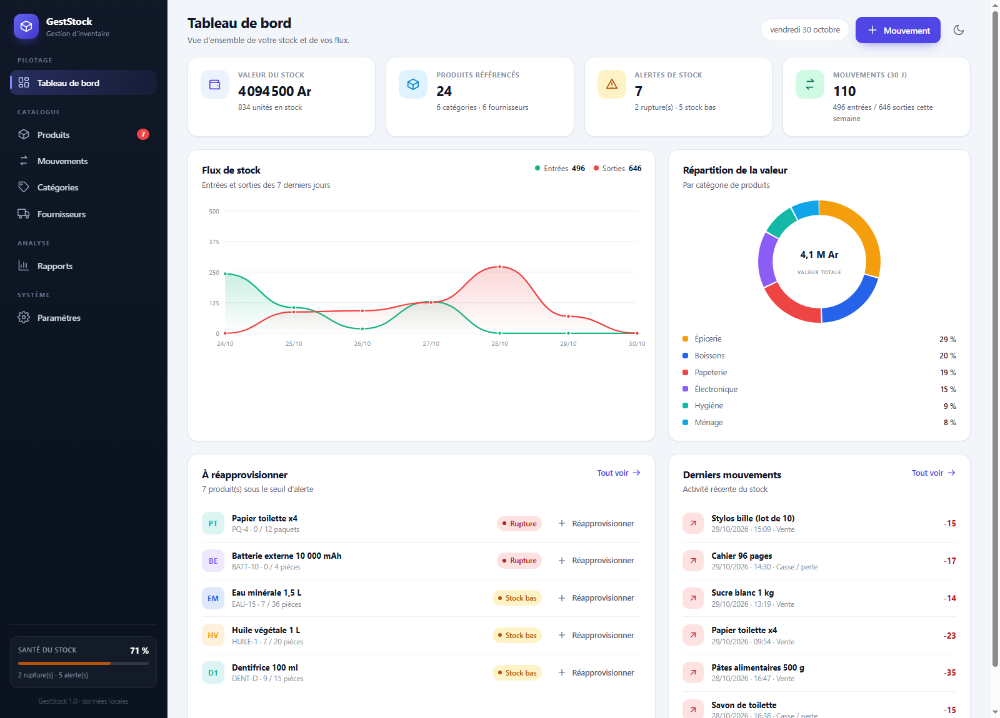
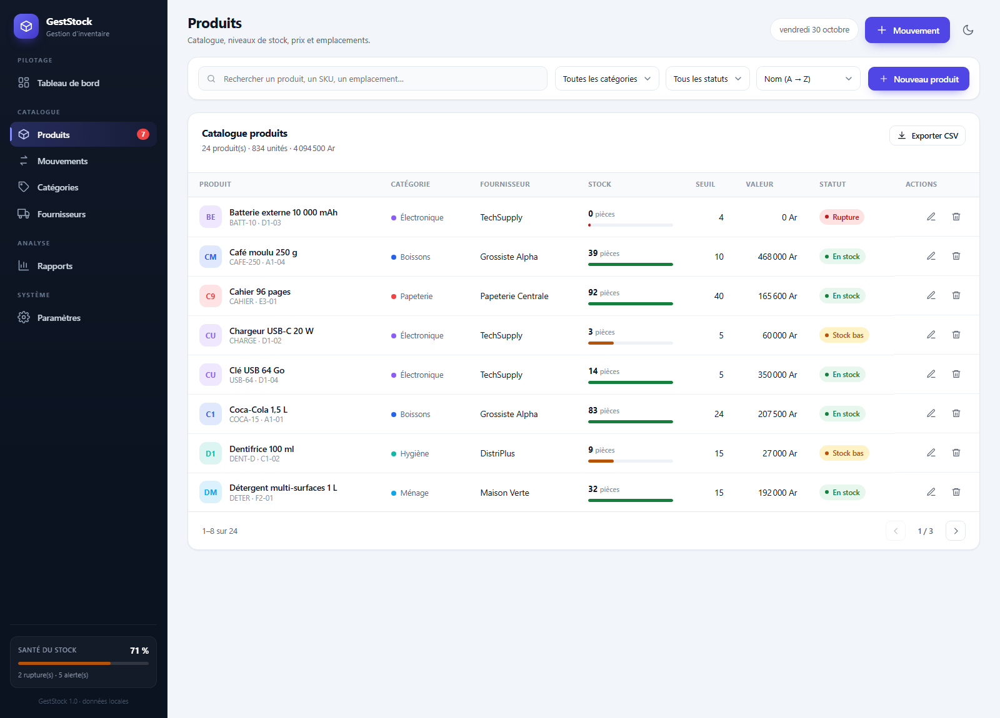
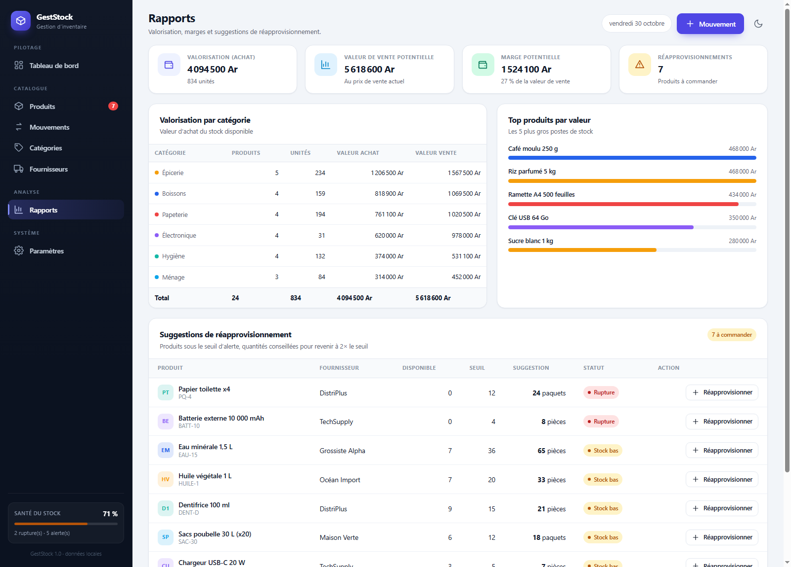
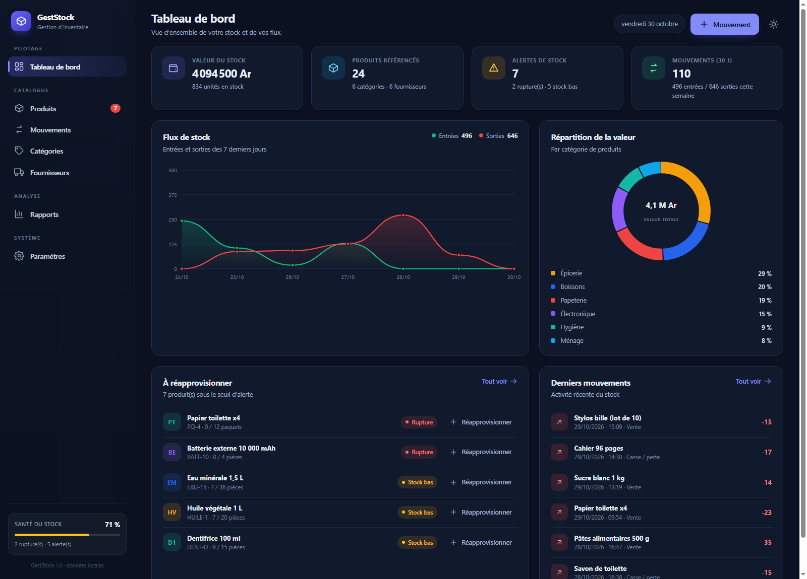
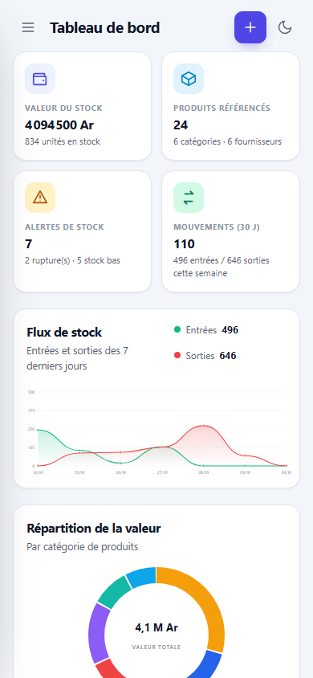

# GestStock — application de gestion de stock

Application web complète de **gestion de stock**, en français, sans dépendance ni étape de build :
HTML, CSS et JavaScript natifs. Le catalogue, les mouvements, les catégories, les fournisseurs et les
paramètres sont persistés localement dans le navigateur (`localStorage`).

Fonctionne aussi bien avec un petit serveur local qu'en ouvrant directement `index.html`.

---

## Aperçu

| Tableau de bord | Produits |
| --- | --- |
|  |  |

| Rapports | Thème sombre |
| --- | --- |
|  |  |

| Mobile |
| --- |
|  |

---

## Fonctionnalités

- **Tableau de bord** : valeur du stock, produits référencés, alertes de stock, mouvements récents,
  courbe des entrées/sorties sur 7 jours, répartition de la valeur par catégorie, produits à
  réapprovisionner et derniers mouvements.
- **Catalogue produits** : création, édition, suppression, recherche plein texte, filtres par
  catégorie et statut, tris (nom, stock, valeur, date), pagination, export CSV.
- **Mouvements de stock** : entrées, sorties et ajustements d'inventaire avec motif, référence, date
  et note. Le stock est refusé si la sortie dépasse la quantité disponible ; le stock après opération
  est prévisualisé en direct. Historique filtrable (type, période, recherche) et export CSV.
- **Catégories** : gestion complète, couleur, description, nombre de produits, unités et valeur.
- **Fournisseurs** : coordonnées, contact, produits fournis, valeur du stock ; suppression bloquée si
  des produits y sont rattachés.
- **Rapports** : valorisation d'achat, valeur de vente potentielle, marge potentielle, détail par
  catégorie, top produits, suggestions de réapprovisionnement (retour à 2× le seuil) et exports.
- **Paramètres** : entreprise, devise (Ariary, euro, dollar, livre, franc suisse), seuil d'alerte par
  défaut, thème clair/sombre, sauvegarde/restauration JSON, réinitialisation et effacement.
- **Confort** : interface responsive (mobile/tablette/desktop), notifications, modales accessibles
  (Échap, clic sur le fond, focus), états vides, thème persistant, aucune donnée envoyée sur un
  serveur.

---

## Démarrage rapide

### Option 1 — avec le petit serveur fourni (recommandé)

```powershell
node server.mjs
```

Puis ouvrir <http://127.0.0.1:4173>.

Le port et l'hôte peuvent être modifiés :

```powershell
$env:PORT=8080; node server.mjs
```

### Option 2 — sans serveur

Ouvrir directement `index.html` dans un navigateur moderne (Chrome, Edge, Firefox, Safari).
L'application fonctionne en `file://` : les modules ES sont chargés localement et les données restent
dans le navigateur.

> Au premier lancement, un **jeu de démonstration** cohérent (24 produits, 6 catégories,
> 6 fournisseurs, plus de 130 mouvements) est chargé. Il est remplaçable à tout moment via
> **Paramètres → Recharger la démo**, ou effaçable via **Tout effacer**.

---

## Structure du projet

```
geststock/
├── index.html              # Coquille de l'application (sidebar, topbar, zones de rendu)
├── assets/
│   ├── styles.css          # Design system, thème clair/sombre, responsive
│   └── favicon.svg
├── js/
│   ├── app.js              # Routeur, vues, modales, formulaires, interactions
│   ├── store.js            # Couche de données pure (validation, stock, persistance, démo)
│   ├── charts.js           # Graphiques SVG générés sans dépendance
│   └── utils.js            # Formatage (devise, dates), helpers, CSV
├── tests/
│   └── store.test.mjs      # 20 tests unitaires de la couche métier
├── scripts/
│   ├── smoke.mjs           # Test d'intégration de bout en bout via CDP
│   ├── screenshots.mjs     # Régénération des captures de documentation
│   └── qa/
│       ├── qa.mjs          # Campagne de recette indépendante (69 contrôles)
│       └── _runs/          # Résultats et fichiers de travail de la recette
├── docs/
│   └── qa-report.md        # Rapport de recette indépendant
├── screenshots/            # Captures d'écran
├── server.mjs              # Serveur statique minimal (aucune dépendance)
├── package.json
└── README.md
```

**Architecture** : `store.js` est une couche pure et testable (aucun accès au DOM) exposant un store
créé par `createStockStore({ storage, now })`. `app.js` consomme ce store et rend les vues dans
`#app` via un routeur basé sur le hash (`#/produits`, `#/mouvements`, …). Les graphiques sont de
simples chaînes SVG ; aucune bibliothèque externe n'est utilisée.

---

## Tests

### Tests unitaires (couche métier)

```powershell
node tests/store.test.mjs
```

20 tests : création/validation des produits, unicité des SKU, entrées/sorties/ajustements, refus de
stock insuffisant, persistance, exports/imports JSON, garde-fous des catégories et fournisseurs,
statistiques, cohérence du jeu de démonstration, recalcul chronologique d'un mouvement antidaté,
validation des dates (passé/futur) et conservation d'un seuil à 0 après import.

### Test d'intégration navigateur (CDP)

Le test `scripts/smoke.mjs` pilote un vrai Chrome via le protocole DevTools : chargement, création de
produit, sortie refusée puis valide, entrée de stock, filtres, pagination, thème sombre, paramètres,
catégories, affichage mobile, absence d'erreurs console.

```powershell
# 1) Lancer l'application
node server.mjs

# 2) Lancer Chrome en mode headless avec le protocole DevTools
#    (adapter le chemin du navigateur installé)
& "C:\Program Files\Google\Chrome\Application\chrome.exe" `
  --headless --disable-gpu --remote-debugging-port=9333 `
  --user-data-dir="$PWD\.qa-chrome-profile" about:blank

# 3) Exécuter le test
node scripts/smoke.mjs
```

Le test se connecte à `http://127.0.0.1:9333`, utilise `APP_URL` (défaut
`http://127.0.0.1:4173/`) et enregistre des captures dans `screenshots/`.

> Dans un environnement confiné, le lancement de Chrome nécessite des canaux IPC ; le test peut être
> exécuté hors sandbox ou sur une machine de développement classique.

---

## Modèle de données

Le store persiste un unique document JSON (clé `geststock.data.v1`) :

```jsonc
{
  "version": 1,
  "settings": { "company": "…", "currency": "MGA", "defaultThreshold": 10, "theme": "light" },
  "categories": [{ "id": "…", "name": "Boissons", "color": "#2563eb", "description": "…" }],
  "suppliers":  [{ "id": "…", "name": "…", "contact": "…", "email": "…", "phone": "…", "address": "…" }],
  "products": [
    {
      "id": "…", "sku": "COCA-15", "name": "Coca-Cola 1,5 L",
      "categoryId": "…", "supplierId": "…",
      "purchasePrice": 2500, "salePrice": 3500,
      "quantity": 83, "threshold": 24, "unit": "pièce",
      "location": "A1-01", "createdAt": "…", "updatedAt": "…"
    }
  ],
  "movements": [
    {
      "id": "…", "productId": "…", "productName": "…", "type": "in", // in | out | adjust
      "quantity": 12, "previousQuantity": 71, "newQuantity": 83, "delta": 12,
      "reason": "Vente", "reference": "TCK-1234", "note": "",
      "date": "…", "createdAt": "…"
    }
  ]
}
```

Règles métier principales :

- `quantity` d'un produit est toujours mise à jour par les mouvements (`in` : +, `out` : −,
  `adjust` : quantité absolue) ; le stock initial crée un mouvement « Stock initial ».
- Le grand livre d'un produit est recalculé **dans l'ordre chronologique des dates** de mouvement ;
  un mouvement antidaté est donc accepté (dans la limite de la date de création du produit) et la
  colonne « Stock après » reste cohérente.
- Une sortie supérieure au stock disponible est refusée.
- Une date de mouvement ne peut pas être dans le futur ni antérieure à la création du produit ;
  les secondes sont prises en compte pour départager deux mouvements d'une même minute.
- Un SKU est unique (insensible à la casse) ; une catégorie/un fournisseur utilisé ne peut pas être
  supprimé.
- Les montants sont libres (prix d'achat/vente) ; la devise ne change que l'affichage.

---

## Sauvegarde et restauration

- **Sauvegarde complète** : Paramètres → *Télécharger une sauvegarde (JSON)*, ou Rapports →
  *Sauvegarde complète (JSON)*.
- **Restauration** : Paramètres → *Restaurer une sauvegarde* ; le fichier est validé avant
  remplacement.
- **Exports tableur** : produits et mouvements au format CSV (`;`, BOM UTF-8, compatible Excel).

Les données restent **exclusivement locales** au navigateur et au profil utilisé.

---

## Limites connues

- Application **mono-utilisateur** : pas de comptes, de synchronisation ni de serveur de données.
- Les données sont liées au navigateur/profil : vider les données de site les supprime ; utilisez
  les sauvegardes JSON pour les transférer.
- Les mouvements sont un journal en ajout seul (pas de suppression/annulation d'un mouvement) ;
  on corrige un stock par un ajustement d'inventaire.
- La devise modifie le formatage, pas de conversion de taux de change.

---

## Licence

Projet de démonstration fourni tel quel, sans garantie.
